# Zhongwen Enhanced — features

A tour of version 2.0, with pictures. The screenshots come from
`e2e/screenshots.mjs`, which loads the built extension into Chromium on a
sample article with a seeded vocabulary.

## Hover to read

Rest the pointer on any Chinese word. The longest dictionary match is
highlighted in the page and a **peek** opens beside it: the word with each
character colored by tone, pinyin, the traditional form, its HSK 3.0 level
and the first senses. The shorter words that start at the same spot are one
click (or `j` / `k`) away as chips. A glance costs nothing; it never covers
more than a line or two.

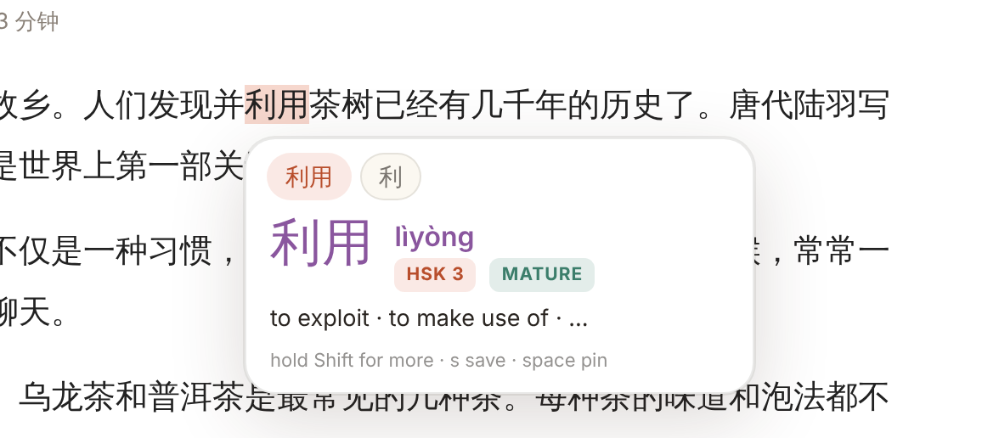

Hold `Shift` (or the key you choose) and the peek grows into the **full
card**: every reading and sense, a tappable breakdown of the characters,
Save / Listen / Copy / Sentence, and links out. Release to shrink back, press
`d` to keep it, or `space` to pin it so you can click inside.

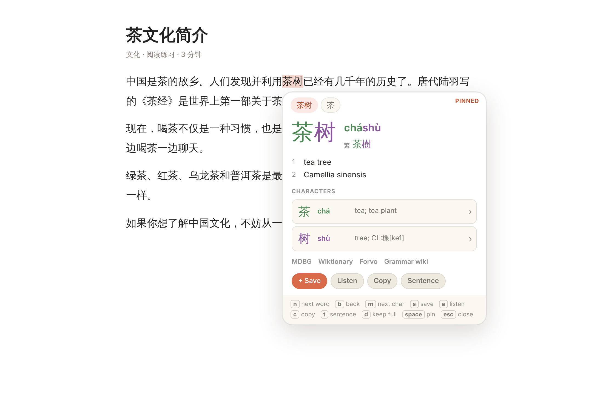

Light and dark themes follow the system, and the tone palette is yours to
choose (Warm, Vivid, Pastel or the Pleco colors).

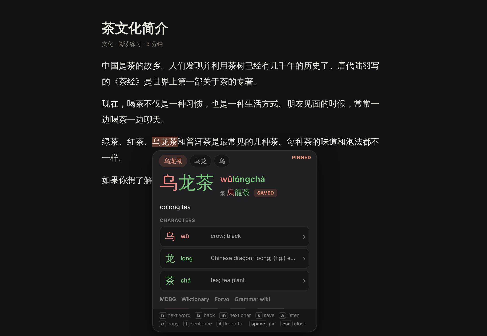

Click a character row to drill into that character's own entry; the chip at
the top takes you back. Click the word or press `space` to pin the card so
you can click inside it.

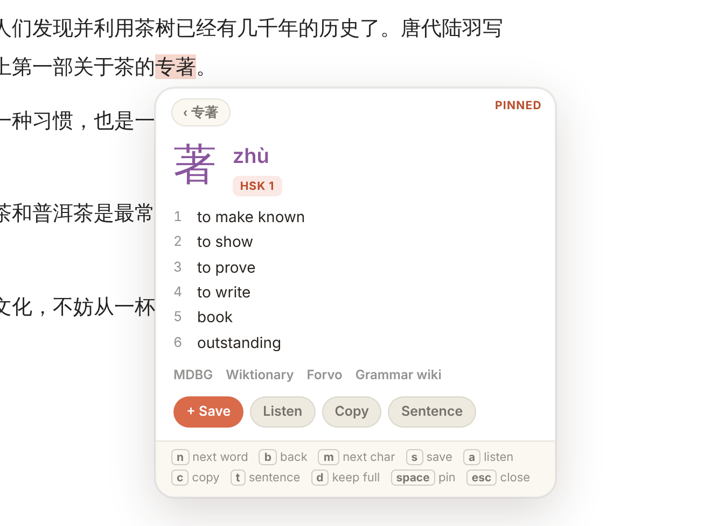

Every card has `Save`, `Listen`, `Copy` and `Sentence`, plus links to MDBG,
Wiktionary, Forvo and the Chinese Grammar Wiki. The strip at the bottom
lists the keys: `n` next word · `b` back · `m` next character · `s` save ·
`a` listen · `c` copy · `t` sentence · `d` keep the full card · `esc` close.

## Sentences, word by word

Press `t` on a card, press `t` with text selected, or right-click a selection
and choose *Break down with Zhongwen*. The sentence is split into words, each
with pinyin and a gloss; click one for its full card, listen to the whole
sentence, copy it, or save it to the Library.

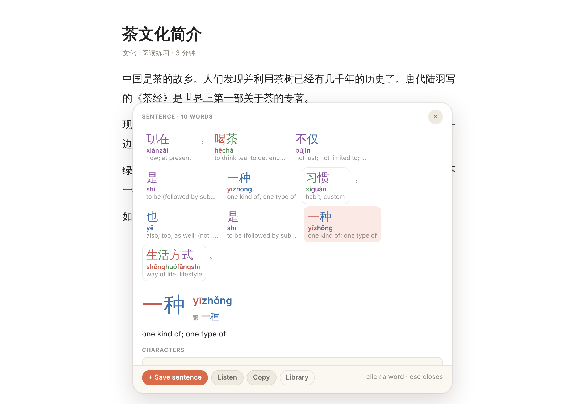

## The toolbar popup

One switch for lookups (also `Alt+Z`), one for the current site, a quick
dictionary search by hanzi, pinyin or English, and today's numbers.

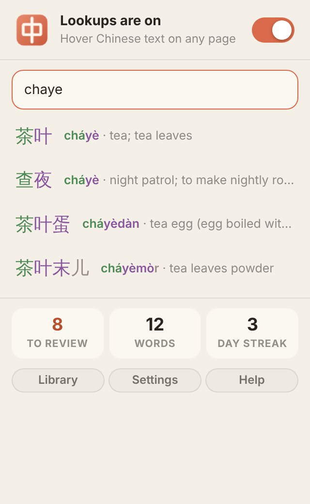

## Vocabulary with context

`s` saves a word together with the sentence it was in, the page title and the
address. The Library groups words by where you found them, with search
(hanzi, pinyin, meaning, sentence), sort by recency / pinyin / due date, a
note per word, and an export menu for the current view (Anki, Pleco, CSV).

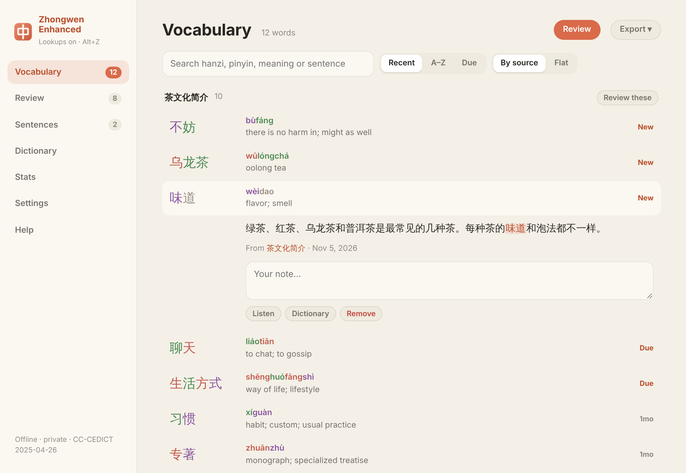

## Review

Flashcards scheduled with FSRS, the algorithm behind modern Anki. The back
shows pinyin, the meaning and the saved sentence; a cloze mode blanks the
word out of its sentence on the front. `space` reveals, `1`–`4` grade, and a
word marked *Again* comes back later in the same session. Daily limits for
new words and reviews live in Settings.

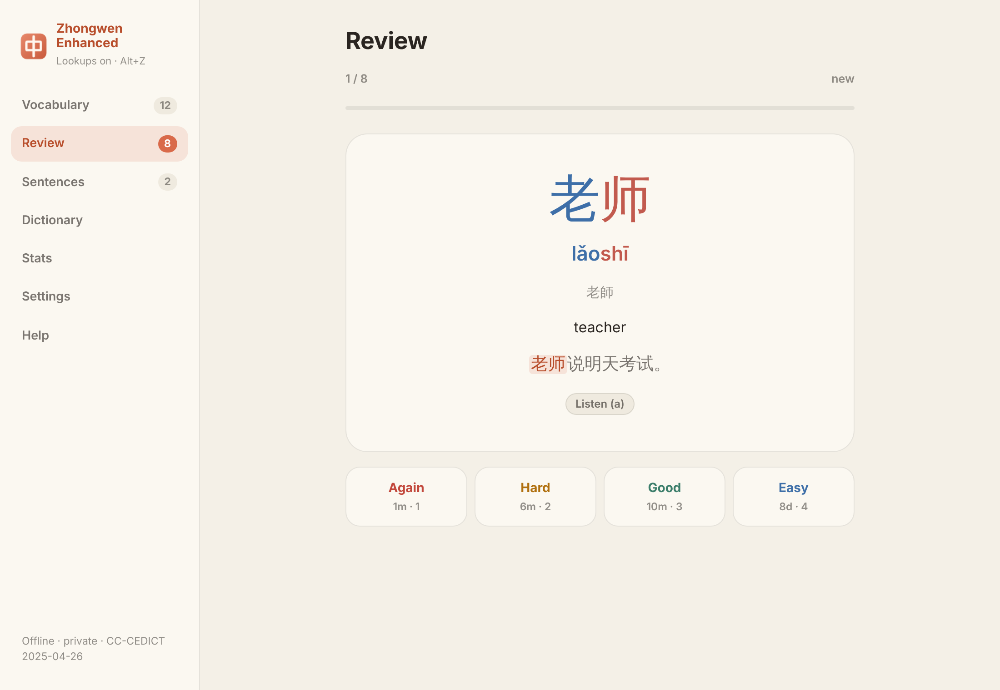

## Saved sentences

Every saved sentence, grouped by source, broken down on demand, with a note
and audio.

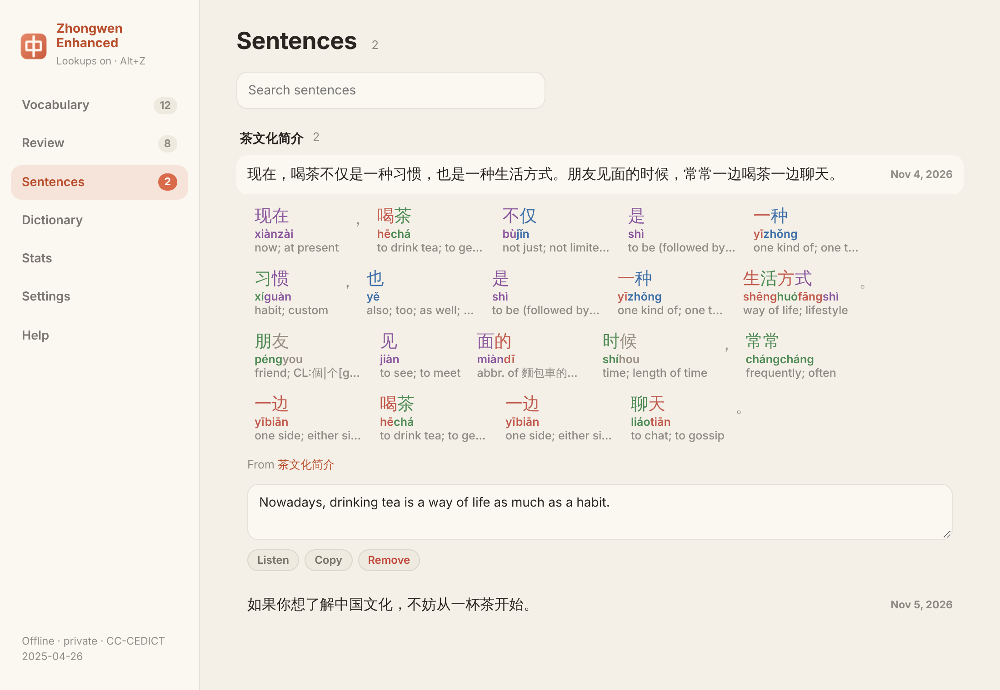

## Dictionary

Search the whole CC-CEDICT by hanzi, pinyin (`nihao`, `ni3hao3` or `nǐhǎo`)
or English. Words you hover on pages appear here as recent lookups.

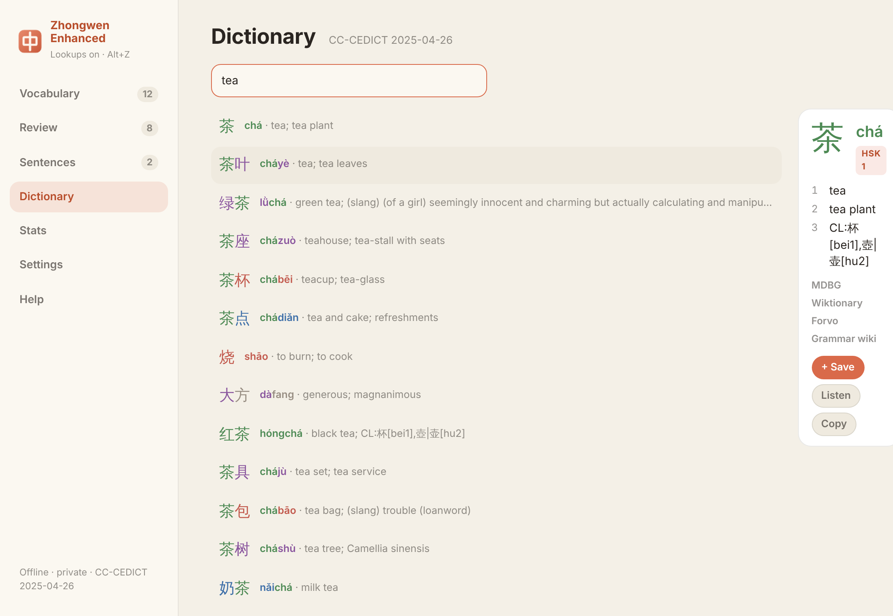

## Stats

Familiarity across your vocabulary, a 26-week activity map, the last 30 days,
and a streak.

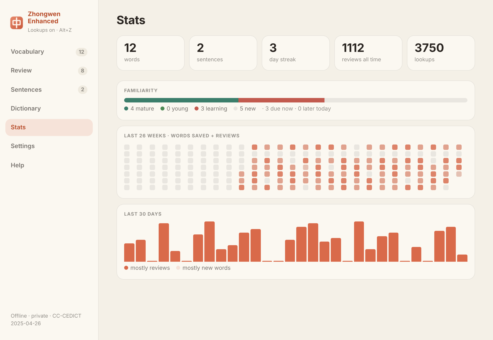

## Settings

Theme, tone palette, pinyin style (marks, numbers, zhuyin), which script
leads, popup size, peek or full card on hover and the key that expands it,
hover vs hold-a-key trigger, hover delay, per-site off list, review limits,
exports, backup and restore. Changes apply immediately,
with a live preview card.

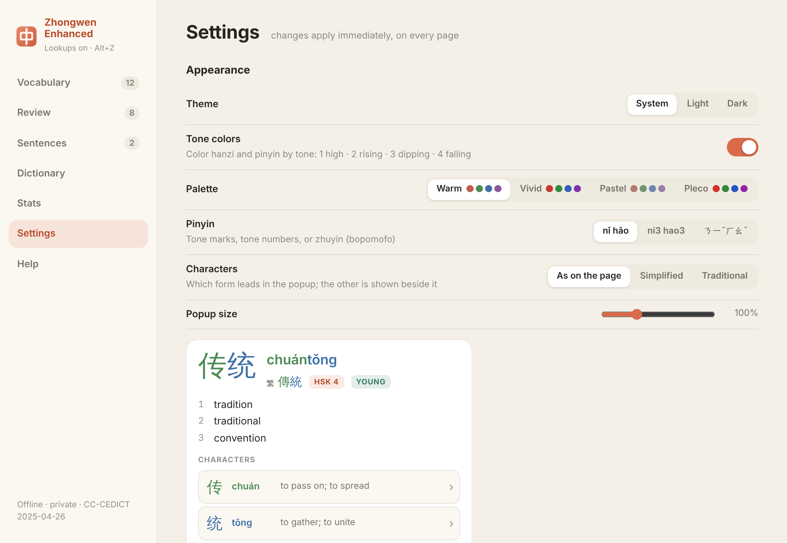

## Private by design

No network permissions. The dictionary ships in the package; everything you
save stays in the browser's extension storage until you export it.
